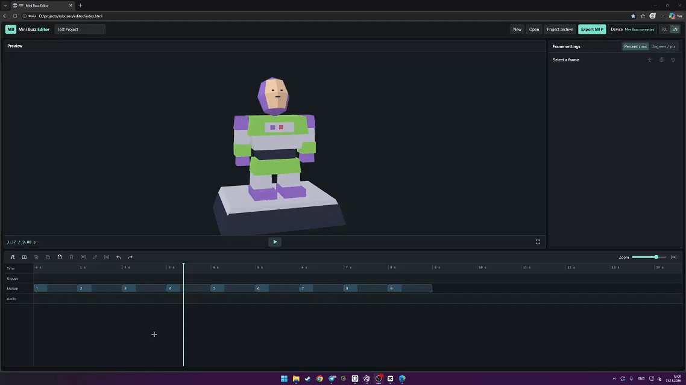
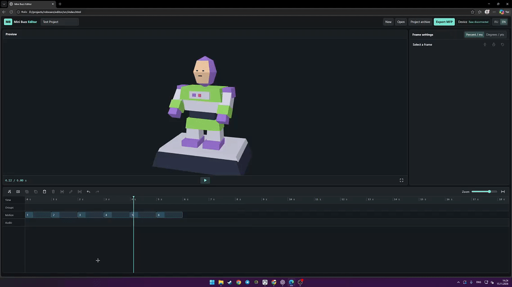
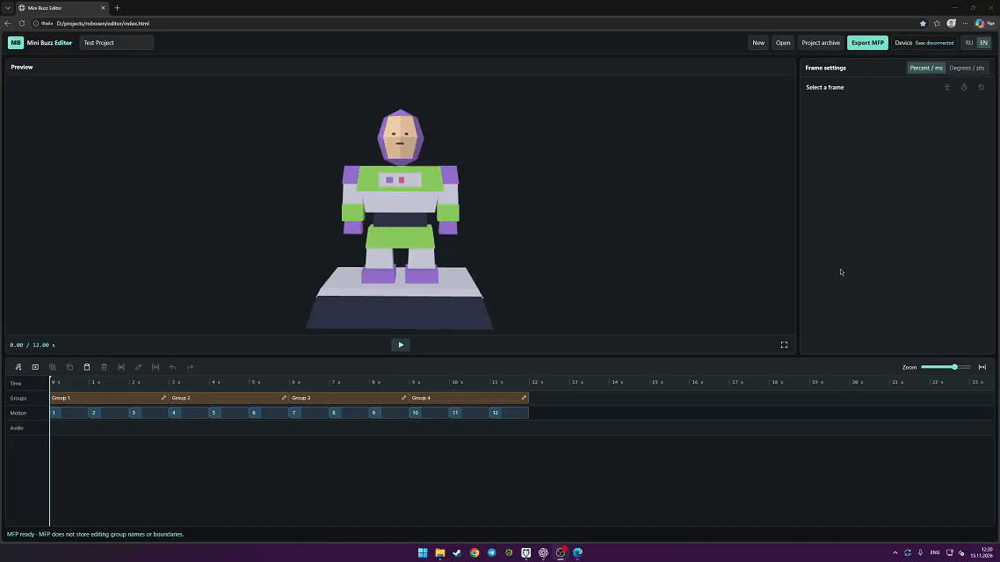
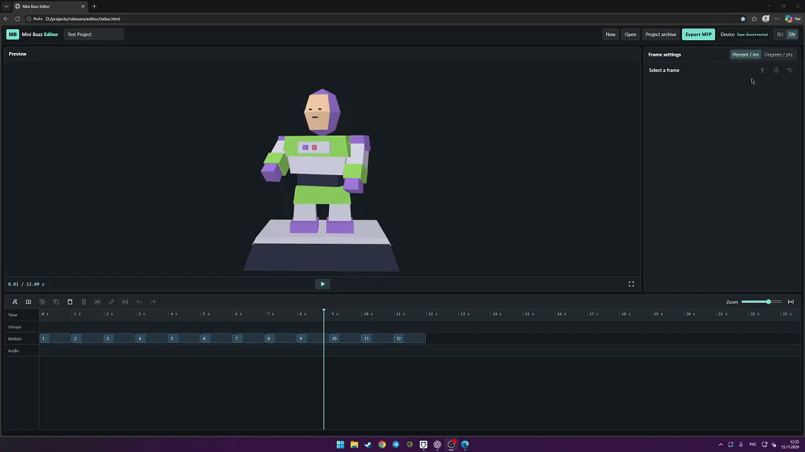
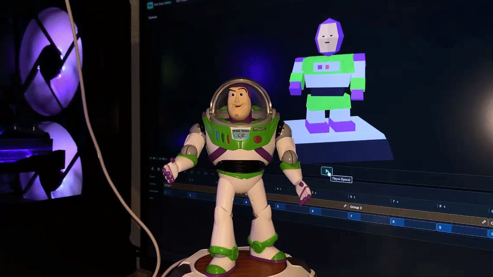

# 🤖 Mini Buzz Editor

Language: English | [Русский](./README_RU.md)

Mini Buzz Editor is an open-source, offline animation editor for Robosen's Buzz Lightyear mini figure. It combines the capabilities of Robosen Studio with features from modern video editors to simplify and speed up the creative process.

---

## 🚀 Getting started

Download and extract the project files. Run [Start.cmd](Start.cmd) or open [src/index.html](src/index.html) in your browser.  
No installation, server, or internet connection is required.

## 📷 Demo

| Working with groups | Copying, pasting, and moving frames |
| :---: | :---: |
|  |  |

| Working with project ZIP and MFP files | Connecting Robosen Mini Base and switching to storage mode |
| :---: | :---: |
|  |  |

| Live preview on the robot over USB |
| :---: |
|  |

---

## ✨ Features

- 3D preview in the editor and live preview on the figure over USB.
- Select, copy, and move frames, work with groups, and undo changes.
- Russian and English interface.
- Choose between degrees and points, as in Robosen Studio, or percentages and milliseconds.
- Open, edit, and export `.mfp` files.
- Save the project as a ZIP containing frame and group information and the MP3 files used in the project.
- Switch Mini Base to USB storage mode.

## ⌨️ Keyboard shortcuts

| Action | Shortcut |
|---|---|
| Play or pause | `Space` |
| Move between frames | `←` / `→` |
| Jump between group starts | `Ctrl+←` / `Ctrl+→` |
| Jump to the start or end of the scene | `Home` / `End` |
| Select a range | `Shift` + arrow key or click |
| Add or remove a single frame from the selection | `Ctrl` + click |
| Add a range to the selection | `Ctrl+Shift` + click |
| Add a frame | `Insert` |
| Duplicate frames | `Ctrl+D` |
| Delete frames | `Delete` |
| Copy | `Ctrl+C` |
| Paste | `Ctrl+V` |
| Create a group | `Ctrl+G` |
| Rename a group | `F2` |
| Ungroup | `Ctrl+Shift+G` |
| Undo | `Ctrl+Z` |
| Redo | `Ctrl+Y` or `Ctrl+Shift+Z` |

Use the mouse wheel to scroll the timeline and `Ctrl` + mouse wheel to zoom.

---

## 🌐 Localization

The editor is available in English and Russian. To translate it into another language, open [src/strings.js](src/strings.js) and replace the text for one language. The first string in each pair is used for **RU**, and the second for **EN**. Keep the keys and the order of the two strings. Reload the page and select the language slot you edited.

## 💾 Bonus. Mini Base file system

After examining the file system on my Mini Base, I was able to replace its stock Chinese voice lines with English audio from Robosen's official resources. The layout below describes what I found on my unit. The layout and behavior may vary on other versions of the base.

> [!WARNING]
> Changes to the file system can disrupt the robot's operation. Before replacing any files, make a complete file-by-file backup of the base's accessible storage.

| Folder | Contents |
|---|---|
| `02/` | Stock voice and sound MP3s referenced by factory actions |
| `SpeAction/` | Factory actions `Action1.sh` through `Action12.sh` |
| `SysAction/` | Startup action `StartAction.sh` and idle actions `PoseAction*.sh` |
| `SysMS/` | System sounds for connection, entry, exit, unpacking, and completion |
| `Action/` | Custom action files |
| `26/` | MP3 for a custom action in the inspected backup |
| `SysCF/` | Model identifier, action list, and custom audio checksums |
| `SHR0/` | Base files whose purpose is unconfirmed |

The `.sh` action files contain 59-byte binary frames. Bytes 57 and 58, counted from zero, can identify an MP3 folder and track number. For example, `SpeAction/Action2.sh` references `02/001.mp3`. Some byte pairs represent audio control commands.

### Replacing a stock voice line

1. Switch the base to USB storage mode from the Device menu. Verify that `SysCF/MODEL` contains `MINI-BUZZ` and back up the files to your computer.
2. Identify the MP3 in your backup by reading the action's audio reference or listening to the original MP3s. For system sounds, check `SysMS/`.
3. Prepare an MP3 from a source you have permission to use. Use the original file's duration, sample rate, channel count, and bitrate as a guide.
4. Replace the intended MP3 at the same path. Safely eject the drive after writing and test one action. If needed, restore the original file from your backup.

I have yet to test replacing stock voice lines with custom recordings. I couldn't find the prompts that play when the base button changes the playback order in the accessible files. They may be built into the base's firmware.

---

## 📄 License

Mini Buzz Editor is an independent project.
Its source code is available under the [MIT License](LICENSE).

The file system guide was prepared for noncommercial purposes. Rights to third-party materials remain with their respective rights holders. The MIT License applies to the editor's source code.

If you believe any project materials infringe your copyright, please contact me at [kolbnestor@gmail.com](mailto:kolbnestor@gmail.com) and identify the materials in question.
