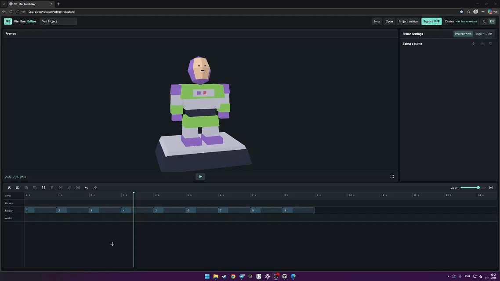
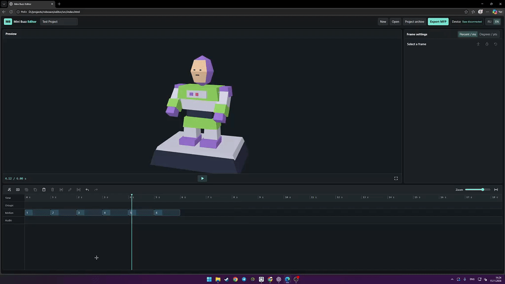
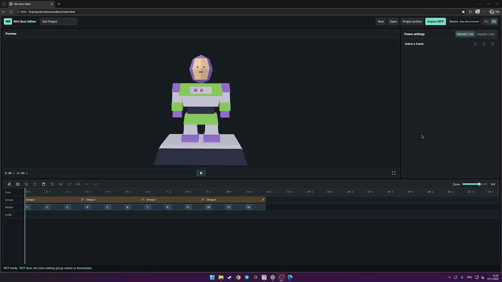
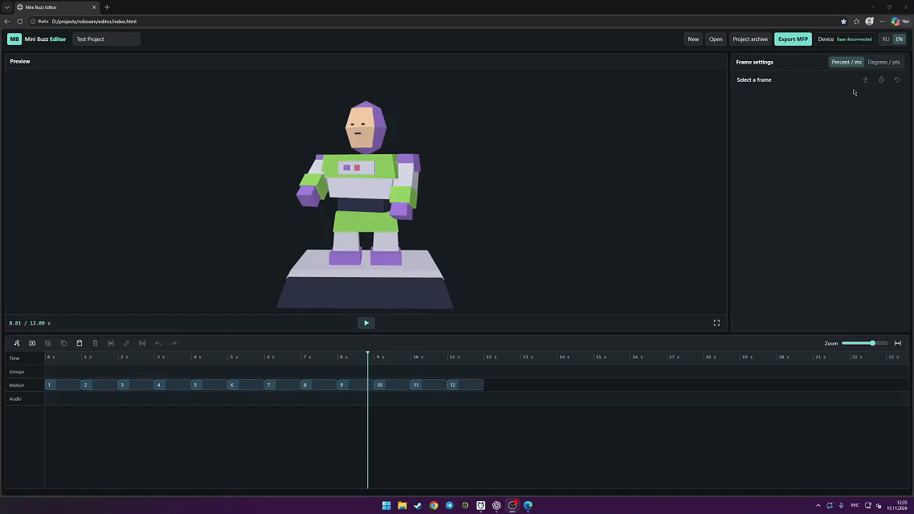
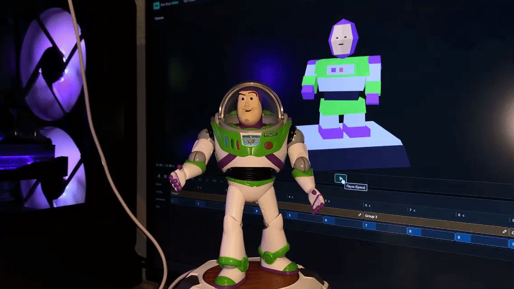

# 🤖 Mini Buzz Editor

Language: [English](./README.md) | Русский

Mini Buzz Editor - открытый офлайн-редактор анимаций для мини-фигурки Базза Лайтера (Buzz Lightyear) от Robosen. Проект совмещает возможности Robosen Studio с функциями современных видеоредакторов, которые упрощают и ускоряют творческий процесс.

---

## 🚀 Запуск

Скачайте и распакуйте файлы проекта. Запустите [Start.cmd](Start.cmd) или откройте [src/index.html](src/index.html) в браузере. 
Установка, сервер или доступ в интернет не требуются.

## 📷 Демонстрация

| Работа с группами | Копирование, вставка и перенос кадров |
| :---: | :---: |
|  |  |

| Работа с ZIP и MFP | Подключение Robosen Mini Base и режим накопителя |
| :---: | :---: |
|  |  |

| Живое превью на роботе по USB |
| :---: |
|  |

---

## ✨ Возможности

- 3D-превью в редакторе и живое превью на фигурке подключенной по USB.
- Выделение, копирование и перенос кадров, работа с группами и отмена действий.
- Русский и английский интерфейс.
- Выбор единиц измерения в интерфейсе:  градусы/пункты (как в оригинальном Robosen Studio) или проценты/миллисекунды.
- Открытие, редактирование и экспорт файлов `.mfp`.
- Сохранение проекта в ZIP с информаций о кадрах, группах и использованными MP3.
- Перевод Mini Base в режим USB-накопителя.

## ⌨️ Горячие клавиши

| Действие | Клавиши |
|---|---|
| Воспроизведение и пауза | `Пробел` |
| Переход по кадрам | `←` / `→` |
| Переход между началами групп | `Ctrl+←` / `Ctrl+→` |
| Начало и конец сцены | `Home` / `End` |
| Выделить диапазон | `Shift` + стрелка или щелчок |
| Добавить или убрать отдельный кадр | `Ctrl` + щелчок |
| Добавить диапазон к выделению | `Ctrl+Shift` + щелчок |
| Добавить кадр | `Insert` |
| Дублировать кадры | `Ctrl+D` |
| Удалить кадры | `Delete` |
| Копировать | `Ctrl+C` |
| Вставить | `Ctrl+V` |
| Создать группу | `Ctrl+G` |
| Переименовать группу | `F2` |
| Разобрать группу | `Ctrl+Shift+G` |
| Отменить действие | `Ctrl+Z` |
| Повторить действие | `Ctrl+Y` или `Ctrl+Shift+Z` |

Колесо прокручивает таймлайн, а `Ctrl` + колесо меняет масштаб.

---

## 🌐 Локализация проекта

Сейчас интерфейс редактора доступен на русском и английском языках. Чтобы локализовать его на другой язык, откройте [src/strings.js](src/strings.js) и замените тексты в одном из языковых вариантов. В каждой паре строк первая относится к режиму **RU**, а вторая к  **EN**. Сохраните ключи и порядок строк, затем обновите страницу редактора и выберите изменённый вариант в переключателе языка.

## 💾 Бонус. Файловая система Mini Base

Немного изучив файловую систему своей Mini Base мне удалось заменить штатные китайские реплики на английские из официальных ресурсов Robosen. Ниже описана структура, которую я наблюдал на своём экземпляре. На других версиях базы структура и поведение могут отличаться.

> [!WARNING]
> Изменения в файловой системе могут нарушить работу робота. Прежде чем что-либо заменять, сделайте полную пофайловую копию доступного содержимого базы.

| Папка | Что в ней хранится |
|---|---|
| `02/` | MP3 штатных реплик и звуков, на которые ссылаются заводские движения |
| `SpeAction/` | Штатные движения `Action1.sh`–`Action12.sh` |
| `SysAction/` | Движение при включении `StartAction.sh` и движения ожидания `PoseAction*.sh` |
| `SysMS/` | Служебные звуки подключения, входа, выхода, распаковки и завершения |
| `Action/` | Сценарии пользовательских движений |
| `26/` | MP3 пользовательского действия в проверенной резервной копии |
| `SysCF/` | Идентификатор модели, список действий и контрольные суммы пользовательского аудио |
| `SHR0/` | Служебные файлы базы, назначение которых не подтверждено |

Файлы движений `.sh` содержат бинарные кадры по 59 байт. Байты 57 и 58 при отсчёте с нуля могут задавать папку и номер MP3. Например, `SpeAction/Action2.sh` ссылается на `02/001.mp3`. Некоторые пары байтов обозначают команды управления звуком.

### Как заменить штатную реплику

1. Переведите базу в режим USB-накопителя через меню «Устройство». Проверьте, что `SysCF/MODEL` содержит `MINI-BUZZ`, и сохраните копию файлов на ПК.
2. Найдите нужный MP3 в своей копии. Ориентируйтесь на ссылку из сценария или прослушайте исходные MP3. Для служебных звуков проверьте `SysMS/`.
3. Подготовьте MP3 из источника, которым вы вправе пользоваться. Возьмите за ориентир длительность, частоту дискретизации, число каналов и битрейт заменяемого файла.
4. Замените только нужный MP3, сохранив имя и расположение. После записи безопасно извлеките накопитель и проверьте одно действие. Если результат не подходит, верните оригинальный файл из резервной копии.

Замену штатных реплик произвольной озвучкой я не проверял. В доступных файлах базы я не нашёл фразы, которые звучат при смене порядка воспроизведения кнопкой на базе. Возможно они вшиты в прошивку базы.

---

## 📄 Лицензия

Mini Buzz Editor разработан как независимый проект. 
Исходный код Mini Buzz Editor открыт и распространяется по [лицензии MIT](LICENSE).

Памятка по файловой системе подготовлена в некоммерческих целях. Права на сторонние материалы сохраняются за соответствующими правообладателями. Лицензия MIT применяется к коду редактора.

Если вы считаете, что материалы проекта нарушают ваши авторские права, пожалуйста, свяжитесь со мной по адресу [kolbnestor@gmail.com](mailto:kolbnestor@gmail.com) и укажите, о каких материалах идёт речь.
